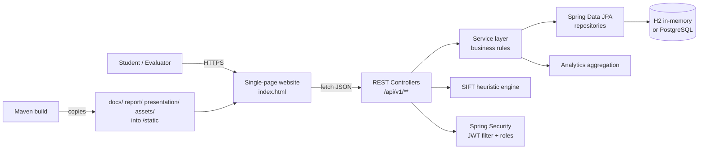

# Architecture & Design

## 1. Overview

TruthLens is a layered Spring Boot web application that serves both a REST API and a static campaign website. It is deliberately small enough to run on a free tier, while still demonstrating production-style separation of concerns, security, validation, testing, and documentation.



## 2. Technology stack

| Layer | Technology |
| :--- | :--- |
| Language | Java 17 |
| Framework | Spring Boot 3.4.3 |
| Web | Spring MVC, Bean Validation |
| Security | Spring Security 6, stateless JWT (JJWT 0.12.6), BCrypt |
| Persistence | Spring Data JPA / Hibernate |
| Databases | H2 in-memory (default), PostgreSQL (optional) |
| API docs | SpringDoc OpenAPI 3 / Swagger UI |
| Frontend | HTML5, Tailwind CSS (CDN), vanilla JavaScript, Font Awesome |
| Testing | JUnit 5, Mockito, MockMvc |
| Build | Maven Wrapper |
| Deployment | Executable JAR, Docker, Render/Railway |

## 3. Package structure

```
com.ashutosh.interviewer
├── InterviewerBackendApplication.java   # Entry point
├── HomeController.java                  # /api/status
├── config/
│   ├── DataInitializer.java             # Seeds demo data
│   ├── SecurityConfig.java              # Route rules, JWT filter, password encoder
│   └── SwaggerConfig.java               # OpenAPI metadata
├── controller/                          # REST endpoints
├── dto/                                 # Request/response contracts + validation
├── exception/                           # Global error handling
├── model/                               # JPA entities
├── repository/                          # Spring Data interfaces
├── security/
│   ├── CustomUserDetailsService.java    # DB-backed user lookup
│   ├── JwtAuthenticationFilter.java     # Bearer token authentication
│   └── JwtUtils.java                    # Sign/parse/validate tokens
└── service/                             # Interfaces + implementations
```

## 4. Request flows

### Fact-check request

1. Browser posts `{claim, category, sourcePlatform}` to `/api/v1/fact-check/verify`.
2. `FactCheckController` validates the DTO.
3. `FactCheckServiceImpl` matches keywords against an in-memory knowledge base and produces a verdict, confidence, SIFT steps, warning flags, sources, and recommended action.
4. The query is stored in `fact_check_queries` for the recent-checks endpoints.
5. The browser renders the result. If the API is unreachable, a client-side copy of the same heuristics keeps the demo functional.

### Workshop registration

1. Browser posts participant details to `/api/v1/workshops/register`.
2. `WorkshopServiceImpl` loads the workshop, rejects full sessions and duplicate emails, increments the counter, and stores a registration.
3. Validation and business errors are mapped to `400` JSON responses by `GlobalExceptionHandler`.

### Analytics

`AnalyticsServiceImpl` combines seeded campaign metrics with live survey aggregates (baseline vs post-campaign averages) and returns a single KPI response consumed by the dashboard.

## 5. Security design

- Stateless sessions; no server-side session state.
- `JwtAuthenticationFilter` extracts a Bearer token, loads the user from the database, and sets the security context.
- Roles are stored on the user (`STUDENT`, `PEER_MULTIPLIER`, `ADMIN`) and mapped to `ROLE_*` authorities.
- Public: website and assets, status, auth, fact-check, modules read, surveys submit, workshops read/register, analytics read.
- Admin-only: module/workshop creation, survey listing, attendee listing, metric updates.
- Passwords are BCrypt-hashed. Demo credentials are seeded only for evaluation and must be replaced in production.
- CSRF is disabled because the API is stateless and token-based; H2 console framing is allowed for local development only.
- `JWT_SECRET` must be overridden with a unique Base64 key in any real deployment.

## 6. Static content pipeline

`docs/`, `report/`, `presentation/`, `assets/`, `CHANGELOG.md`, and `PROJECT_PLAN.md` are copied into `target/classes/static/` by the Maven resources plugin. This gives a single source of truth in the repository while serving the same files at:

- `/docs/**`
- `/report/**`
- `/presentation/**`
- `/assets/**`

The Dockerfile copies those folders before running Maven, so the deployed JAR contains the same content.

## 7. Data design

See [DATABASE_SCHEMA.md](DATABASE_SCHEMA.md). Entities: `User`, `MisinformationModule`, `CampaignSurvey`, `Workshop`, `WorkshopRegistration`, `FactCheckQuery`, `CampaignMetric`.

Relationships are intentionally simple: surveys optionally reference a user; registrations reference a workshop and optionally a user. Seed data is inserted by `DataInitializer` when a table is empty.

## 8. Quality attributes

| Attribute | Approach |
| :--- | :--- |
| Maintainability | Controller → service → repository layering; DTO validation; constructor injection |
| Testability | 21 automated tests covering context, JWT security, controllers, and service business rules |
| Portability | H2 default; PostgreSQL via environment variables |
| Reliability | Client-side SIFT fallback; explicit error responses; idempotent seed checks |
| Security | JWT filter, role checks, BCrypt, input validation, output escaping in the UI |
| Observability | `/api/status`, structured HTTP errors, Swagger |
| Deployability | Maven Wrapper, executable JAR, Dockerfile, Render blueprint |

## 9. Known limitations

- The SIFT engine is heuristic, not a live fact-check integration.
- H2 is in-memory; data resets on restart unless PostgreSQL is configured.
- The frontend loads Tailwind, Font Awesome, and Google Fonts from CDNs, so an offline demo may lose styling or icons.
- Admin UI is Swagger/API-only; no separate admin dashboard is included.
- The project is a single deployable unit, not a microservice architecture, by design.

## 10. Future work

- Integrate an IFCN-certified fact-check API and cache results.
- Add a WhatsApp Cloud API bot using the blueprint in `WHATSAPP_BOT_GUIDE.md`.
- Add an admin dashboard and audit trail.
- Persist surveys and registrations in PostgreSQL with backups.
- Add end-to-end browser tests and CI.
