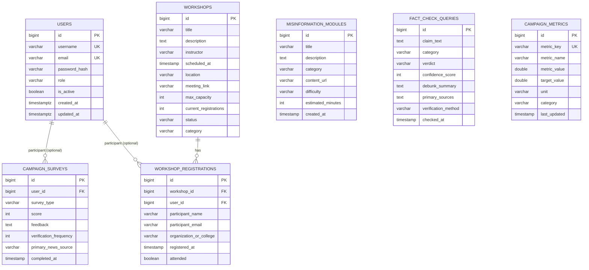

# Database Schema

TruthLens uses Spring Data JPA with Hibernate. The default profile runs an H2 in-memory database in PostgreSQL compatibility mode; the same entities work with PostgreSQL when the datasource environment variables are set.

- Schema management: `spring.jpa.hibernate.ddl-auto=update`
- Default H2 URL: `jdbc:h2:mem:truthlens_db;DB_CLOSE_DELAY=-1;DB_CLOSE_ON_EXIT=FALSE;MODE=PostgreSQL`
- Seed data: `src/main/java/com/ashutosh/interviewer/config/DataInitializer.java`
- No migration tool (Flyway/Liquibase) is included; this is a demo-grade schema.

## 1. Entity relationship diagram

## 2. Tables

### `users`

| Column | Type | Constraints | Notes |
| :--- | :--- | :--- | :--- |
| `id` | BIGINT | PK, identity | |
| `username` | VARCHAR(50) | NOT NULL, UNIQUE | Login identifier |
| `email` | VARCHAR(100) | NOT NULL, UNIQUE | JWT subject |
| `password_hash` | VARCHAR(255) | NOT NULL | BCrypt hash |
| `role` | VARCHAR(20) | NOT NULL | `STUDENT`, `PEER_MULTIPLIER`, `ADMIN` |
| `is_active` | BOOLEAN | NOT NULL, default true | Disabled users cannot authenticate |
| `created_at` | TIMESTAMPTZ | | Set on insert |
| `updated_at` | TIMESTAMPTZ | | Set on insert/update |

### `misinformation_modules`

| Column | Type | Constraints | Notes |
| :--- | :--- | :--- | :--- |
| `id` | BIGINT | PK, identity | |
| `title` | VARCHAR(255) | NOT NULL | |
| `description` | TEXT | NOT NULL | |
| `category` | VARCHAR(255) | NOT NULL | e.g. `HEALTH_MYTHS`, `DEEPFAKES` |
| `content_url` | VARCHAR(255) | NOT NULL | Usually `/docs/...` |
| `difficulty` | VARCHAR(255) | default `BEGINNER` | |
| `estimated_minutes` | INT | default 15 | |
| `created_at` | TIMESTAMP | | Set on insert |

### `campaign_surveys`

| Column | Type | Constraints | Notes |
| :--- | :--- | :--- | :--- |
| `id` | BIGINT | PK, identity | |
| `user_id` | BIGINT | FK → `users.id`, nullable | Optional linked account |
| `survey_type` | VARCHAR(255) | NOT NULL | `BASELINE` or `POST_CAMPAIGN` |
| `score` | INT | NOT NULL | 0–10 susceptibility score |
| `feedback` | TEXT | nullable | Free text / self-check details |
| `verification_frequency` | INT | nullable | 1–5 |
| `primary_news_source` | VARCHAR(255) | nullable | `WHATSAPP`, `INSTAGRAM`, etc. |
| `completed_at` | TIMESTAMP | NOT NULL | Set on insert |

Survey responses contain an identifier (`participantEmail` is converted into an optional user or stored in `feedback` context by the service; see `CampaignServiceImpl`). Admin-only endpoints expose the full records.

### `workshops`

| Column | Type | Constraints | Notes |
| :--- | :--- | :--- | :--- |
| `id` | BIGINT | PK, identity | |
| `title` | VARCHAR(255) | NOT NULL | |
| `description` | TEXT | NOT NULL | |
| `instructor` | VARCHAR(255) | NOT NULL | Facilitator |
| `scheduled_at` | TIMESTAMP | NOT NULL | Local date-time |
| `location` | VARCHAR(255) | NOT NULL | Venue or online |
| `meeting_link` | VARCHAR(255) | nullable | Demo placeholder |
| `max_capacity` | INT | NOT NULL, default 100 | |
| `current_registrations` | INT | NOT NULL, default 0 | Incremented on registration |
| `status` | VARCHAR(255) | NOT NULL, default `UPCOMING` | `UPCOMING`, `IN_PROGRESS`, `COMPLETED` |
| `category` | VARCHAR(255) | NOT NULL | e.g. `FACT_CHECKING_TOOLS` |

### `workshop_registrations`

| Column | Type | Constraints | Notes |
| :--- | :--- | :--- | :--- |
| `id` | BIGINT | PK, identity | |
| `workshop_id` | BIGINT | FK → `workshops.id`, NOT NULL | |
| `user_id` | BIGINT | FK → `users.id`, nullable | |
| `participant_name` | VARCHAR(255) | NOT NULL | |
| `participant_email` | VARCHAR(255) | NOT NULL | Unique per workshop (enforced in service) |
| `organization_or_college` | VARCHAR(255) | nullable | |
| `registered_at` | TIMESTAMP | NOT NULL | Set on insert |
| `attended` | BOOLEAN | NOT NULL, default false | |

### `fact_check_queries`

| Column | Type | Constraints | Notes |
| :--- | :--- | :--- | :--- |
| `id` | BIGINT | PK, identity | |
| `claim_text` | TEXT | NOT NULL | Submitted claim |
| `category` | VARCHAR(255) | NOT NULL | `HEALTH`, `FINANCIAL`, `POLITICS`, etc. |
| `verdict` | VARCHAR(255) | NOT NULL | `VERIFIED_FALSE`, `MISLEADING`, ... |
| `confidence_score` | INT | NOT NULL | 0–100 |
| `debunk_summary` | TEXT | NOT NULL | |
| `primary_sources` | TEXT | nullable | Comma-separated or JSON list |
| `verification_method` | VARCHAR(255) | NOT NULL | e.g. `SIFT_FRAMEWORK` |
| `checked_at` | TIMESTAMP | NOT NULL | Set on insert |

### `campaign_metrics`

| Column | Type | Constraints | Notes |
| :--- | :--- | :--- | :--- |
| `id` | BIGINT | PK, identity | |
| `metric_key` | VARCHAR(255) | NOT NULL, UNIQUE | e.g. `campaign_reach_impressions` |
| `metric_name` | VARCHAR(255) | NOT NULL | Human-readable label |
| `metric_value` | DOUBLE | NOT NULL | Achieved value |
| `target_value` | DOUBLE | NOT NULL | KPI target |
| `unit` | VARCHAR(255) | NOT NULL | impressions, participants, % |
| `category` | VARCHAR(255) | NOT NULL | `REACH`, `EDUCATION`, etc. |
| `last_updated` | TIMESTAMP | NOT NULL | Set on insert/update |

## 3. Seed data

`DataInitializer` runs at startup and only inserts when a table is empty.

| Table | Rows | Summary |
| :--- | :--- | :--- |
| `users` | 3 | Admin, peer multiplier, student |
| `misinformation_modules` | 6 | SIFT, deepfakes, WhatsApp rumors, health myths, tools, scams |
| `workshops` | 2 | SIFT tools + deepfake forensics |
| `campaign_metrics` | 5 | Reach, workshop participants, susceptibility reduction, verification adoption, multipliers |
| `campaign_surveys` | 4 | 2 baseline and 2 post-campaign samples |

## 4. Reference DDL

`src/main/resources/db/schema.sql` contains a PostgreSQL reference for the `users` table. It is not executed automatically (`spring.sql.init.mode=never`); Hibernate creates the actual schema from the entities. Treat it as documentation rather than a migration.

## 5. Data lifecycle and privacy

- H2 data lives only for the process lifetime. Restarting the app resets all records to the seed state.
- PostgreSQL deployments persist data and should use a managed backup policy.
- Workshop registration and survey endpoints accept an email; admin-only lists expose them. Use a real privacy notice, consent, and retention policy before collecting data from the public.
- Demo credentials and the default `JWT_SECRET` must be replaced before any public deployment.
