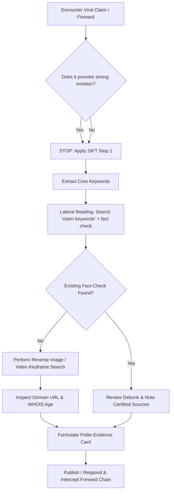

# S-09 Open-Access Fact-Checking Resource Guide & Toolkit

## 1. Introduction
The **TruthLens Open-Access Fact-Checking Guide** is a practical, curated manual designed for students, educators, community leaders, and campus journalists to rapidly verify digital claims, investigate synthetic media, and locate authoritative evidence.

---

## 2. Core Verification Framework: SIFT
Developed by digital literacy researcher Mike Caulfield, the **SIFT Framework** is the global standard for rapid verification:

```
  [S] STOP                     --> Pause emotional response, do not react or forward immediately.
  [I] INVESTIGATE THE SOURCE   --> Who is behind the information? Check the publisher, author, URL.
  [F] FIND BETTER COVERAGE     --> Lateral reading: Look for trusted reporting and fact-checking consensus.
  [T] TRACE CLAIMS & CONTEXT   --> Track media and quotes back to original, unedited source files.
```

---

## 3. Essential Fact-Checking Tools Catalog

### 3.1 Reverse Image Search Engines
When images are recycled, edited, or attributed to the wrong event, reverse image search tools reveal their original publication history:

| Tool | Best For | URL / Access | Key Strength |
| :--- | :--- | :--- | :--- |
| **Google Lens** | General object, face, text & landmark search | [lens.google.com](https://lens.google.com) | Superior AI recognition for partial crops and multi-lingual text extraction. |
| **TinEye** | Historical publication timeline & duplicates | [tineye.com](https://tineye.com) | Sorts matches by "Oldest", showing the earliest recorded appearance online. |
| **Yandex Images** | Facial recognition & obscure international sources | [yandex.com/images](https://yandex.com/images) | Highly effective for identifying faces, foreign locales, and background scenes. |
| **Bing Visual Search** | E-commerce items, logos, and monuments | [bing.com/visualsearch](https://bing.com/visualsearch) | Deep web indexing of consumer and corporate assets. |

---

### 3.2 Video Verification & Forensic Tools
Manipulated videos often stitch real footage with false soundtracks or crop timestamps.

| Tool | Core Capability | Workflow |
| :--- | :--- | :--- |
| **InVID / WeVerify Plugin** | Video Keyframe Extraction & Forensic Filters | 1. Paste YouTube / Twitter / Facebook video URL into InVID.<br>2. Generate keyframe snapshots.<br>3. Right-click keyframes to reverse search on Google / TinEye. |
| **YouTube Dataviewer (Amnesty)** | Exact UTC Upload Timestamp Extractor | Paste YouTube link to reveal exact hour/minute of upload, exposing claims about "breaking" live events. |
| **FotoForensics** | Error Level Analysis (ELA) & Metadata | Highlights compression differences in modified or photoshopped images. |

---

### 3.3 Domain & Website Provenance Verification
Scammers frequently clone trusted institutional websites using lookalike domains (e.g., `who-int.org.fake` instead of `who.int`).

| Tool | Purpose | Key Check |
| :--- | :--- | :--- |
| **Whois Lookup (ICANN / DomainTools)** | Domain Registration Age & Ownership | Check `Creation Date`. A claim from an "official ministry" whose domain was registered 3 days ago is a fraudulent clone. |
| **Wayback Machine (Internet Archive)** | Archived Historical Snapshots | View deleted posts, modified headlines, and historical website content over time ([archive.org](https://archive.org)). |
| **Google Cache / Archive.today** | Immediate webpage caching | Bypasses paywalls and captures live snapshots before removal ([archive.today](https://archive.today)). |

---

## 4. Recognized IFCN-Certified Fact-Checking Portals

Always cross-reference domestic and international viral claims with verified fact-checking organizations accredited by the **International Fact-Checking Network (IFCN)**:

```
+-------------------------------------------------------------------------+
|                  CERTIFIED FACT-CHECKING NETWORKS                       |
+-------------------------------------------------------------------------+
  * BOOM Live (https://www.boomlive.in)             - Health, Politics, Media
  * Alt News (https://www.altnews.in)               - Misinformation & Communal
  * Vishvas News (https://www.vishvasnews.com)      - Multi-lingual Indian Languages
  * Snopes (https://www.snopes.com)                 - Global Urban Legends & Hoaxes
  * FactCheck.org (https://www.factcheck.org)       - Science, Health & Public Policy
  * PIB Fact Check (https://factcheck.pib.gov.in)   - Official Indian Government Notices
  * WHO Mythbusters (https://www.who.int)           - Global Health & Disease Cures
```

---

## 5. Step-by-Step Fact-Checking Workflow Checklist



---

## 6. Guidelines for Student Journalists & Multipliers
1. **Never Re-share the Uncorrected Misinformation Plainly:** When debunking, place a prominent red **"FALSE"** or **"FABRICATED"** watermark over the hoax screenshot to avoid accidental algorithmic amplification.
2. **Lead with the Truth:** State the fact first, explain the deception second, and explain why the myth is wrong third (*The "Truth Sandwich" method*).
3. **Cite Accessible Evidence:** Provide direct URLs rather than screenshots alone.
