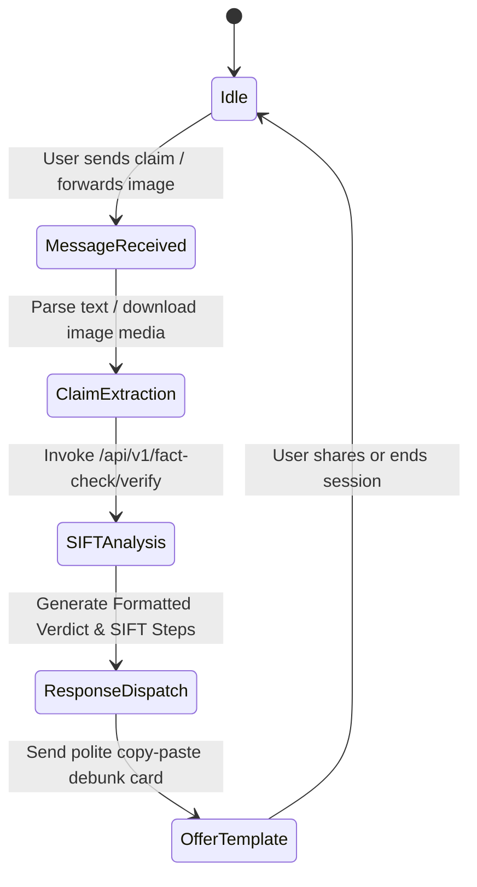

# S-09 WhatsApp "Rumor Radar" Automated Bot Architecture & Integration Guide

## 1. Overview
The **TruthLens WhatsApp Rumor Radar Bot** is an automated digital verification assistant built to operate within encrypted messaging ecosystems (WhatsApp Business Cloud API). It allows students and community members to forward suspicious text claims, images, and links directly to a dedicated WhatsApp helpline to receive instant SIFT breakdowns, IFCN-verified fact-checks, and polite debunking copy cards.

---

## 2. System Architecture

```
+------------------+         +-------------------------------+         +-----------------------+
|  Student User    | ------> |  Meta WhatsApp Cloud API      | ------> | TruthLens Webhook     |
| (WhatsApp Chat)  | <------ |  (Webhook Inbound / Outbound) | <------ | /api/v1/webhook/wa    |
+------------------+         +-------------------------------+         +-----------------------+
                                                                                   |
                                                                       +-----------v-----------+
                                                                       | TruthLens Core Engine |
                                                                       | * SIFT Heuristic      |
                                                                       | * IFCN API Search     |
                                                                       | * Reverse Image Query |
                                                                       +-----------------------+
```

---

## 3. Webhook Endpoint Specifications

### 3.1 Webhook Verification (GET `/api/v1/webhook/whatsapp`)
- **Query Parameters:**
  - `hub.mode=subscribe`
  - `hub.challenge=CHALLENGE_CODE`
  - `hub.verify_token=TRUTHLENS_SECRET_TOKEN`
- **Response:** Returns `hub.challenge` string with HTTP 200.

### 3.2 Inbound Message Processing (POST `/api/v1/webhook/whatsapp`)
```json
{
  "object": "whatsapp_business_account",
  "entry": [
    {
      "id": "WHATSAPP_BUSINESS_ID",
      "changes": [
        {
          "value": {
            "messaging_product": "whatsapp",
            "metadata": {
              "display_phone_number": "15550234567",
              "phone_number_id": "100234567890123"
            },
            "contacts": [{ "profile": { "name": "Student User" }, "wa_id": "919876543210" }],
            "messages": [
              {
                "from": "919876543210",
                "id": "wamid.HBgLOTE5ODc2NTQzMjEwFQIAEhgWM0VFRjE4OTIz",
                "timestamp": "1725400000",
                "text": { "body": "Is it true government giving free laptops at bit.ly/free-laptop-gov?" },
                "type": "text"
              }
            ]
          },
          "field": "messages"
        }
      ]
    }
  ]
}
```

---

## 4. Bot Conversation Flow & State Machine



---

## 5. Sample Bot Response Message Format

```
🔍 *TRUTHLENS FACT-CHECK REPORT*
━━━━━━━━━━━━━━━━━━━━━
❌ *VERDICT: FALSE / PHISHING SCAM*
*Confidence Score:* 98%

*Summary Diagnosis:*
The link "bit.ly/free-laptop-gov" is an unauthorized phishing campaign. The Ministry of Education has issued no such free laptop distribution scheme.

📋 *SIFT Breakdown:*
• *S - STOP:* Phishing scams rely on false urgency.
• *I - INVESTIGATE:* Real government portals always end in `.gov.in` or `.nic.in`.
• *F - FIND COVERAGE:* PIB Fact Check verified this as fraudulent: https://factcheck.pib.gov.in/

💬 *Want to reply to the person who sent you this?*
_Copy & paste this polite text:_
"⚠️ Hi, this free laptop message is a scam trying to steal login info. PIB confirmed it is fake: https://factcheck.pib.gov.in. Please do not click!"
```

---

## 6. Deployment & Environment Setup
To deploy the WhatsApp Bot service:
1. Register a Meta Developer Application at [developers.facebook.com](https://developers.facebook.com).
2. Configure WhatsApp Cloud API phone number and generate permanent System User Token.
3. Set environment variables in application runtime:
   ```properties
   truthlens.whatsapp.token=YOUR_SYSTEM_USER_ACCESS_TOKEN
   truthlens.whatsapp.verify-token=YOUR_CHOSEN_WEBHOOK_VERIFY_TOKEN
   truthlens.whatsapp.phone-id=YOUR_PHONE_NUMBER_ID
   ```
4. Run TruthLens backend behind SSL proxy (e.g. Nginx or Cloudflare Tunnel) with webhook URL pointing to `https://your-domain.edu/api/v1/webhook/whatsapp`.
